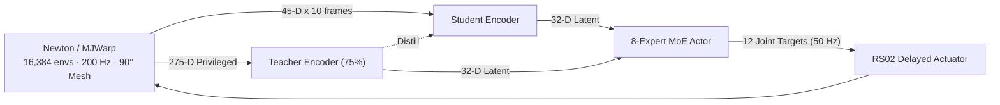

# Lope Locomotion

[](https://www.python.org/)
[](https://github.com/isaac-sim/IsaacLab)
[](https://github.com/newton-physics/newton)

MoE-CTS locomotion training, crisp playback, and deployment export for the **Lope** 12-DoF fixed-foot quadruped (`lope-locomotion-mixed`) on **Isaac Lab 3.0** and **Newton / MuJoCo-Warp**.

## Highlights

- **14S RS02 4-Quadrant Delayed Actuators** — Battery-aware motoring/braking torque-speed envelope (`14.5/16.5 N·m` hip & thigh, `28.0/32.0 N·m` 2:1 calf) with randomized `0–15 ms` control latency.
- **True 90° Triangle-Mesh Terrain** — `convert_to_heightfield = False` across all sub-terrains so Newton collides directly against watertight 90° stairs (`5–25 cm`) and `0–35°` slopes.
- **Yaw-Aware Curriculum & 30 N Leg Contact Penalty** — Prevents curved-yaw false demotions (`LopeVelCommand` + `LopeTerrainLevelsCurriculum`) while penalizing shin/thigh strikes on stair risers (`> 30 N`).
- **Cleaned Self-Collision URDF & Exact 12-DoF Symmetry** — Phantom internal collisions removed (`self_collision = True`) with exact sagittal `FR↔FL / RR↔RL` mirror augmentation.
- **Crisp Two-Tone Playback & Export** — Flat-shaded tread/riser + dark edge overlay for Newton GL videos, plus standalone TorchScript (`policy.pt`) and ONNX (`policy.onnx`) export.

## Architecture



## Quick Start

Requires Linux + CUDA GPU with Python 3.12, **Isaac Lab 3.0.0**, **Newton / MJWarp**, and the pinned `upstream/go2_rl_lab` (`rsl-rl-lib 3.3.0`).

```bash
git clone --recurse-submodules --branch lope-locomotion https://github.com/Kitjesen/CTSMOE.git
cd CTSMOE
uv pip install --python /path/to/IsaacLab3/.venv/bin/python --no-deps -e .
```

> `launch_lope.py` prints a dry-run JSON plan by default; pass `--execute` to run.

```bash
# Smoke test (32 envs, 2 updates)
python scripts/rsl_rl/launch_lope.py train --num-envs 32 --updates 2 --seed 42 --run-name lope-smoke --execute

# Full training (16,384 envs, 100k updates)
python scripts/rsl_rl/launch_lope.py train --num-envs 16384 --updates 100000 --seed 42 --run-name lope-locomotion --execute

# Resume from checkpoint (--updates = remaining budget up to 100,000; add LOPE_ALLOW_CONTRACT_MIGRATION=1 if migrating curriculum/rewards)
python scripts/rsl_rl/launch_lope.py train \
  --resume --checkpoint /abs/path/to/model_22501.pt \
  --num-envs 16384 --updates 77499 --seed 42 --run-name lope-resume --execute

# Playback with crisp 90° stairs video + TorchScript / ONNX export
python scripts/rsl_rl/launch_lope.py play \
  --checkpoint /abs/path/to/model_23001.pt \
  --terrain stairs_up --level 5 --num-envs 4 --video --video-length 600 --execute
```

## Key Specs

| Item | Value |
| --- | --- |
| **Robot** | 12-DoF fixed-foot quadruped (`13.33 kg`, `self_collision = True`, stand `0.295 m` / target `0.300 m`, hip `0.360 m`) |
| **Actuators** | `RS02Actuator` @ 14S: hip/thigh `14.5/16.5 N·m` (`Kp=40, Kd=0.8`), calf 2:1 `28.0/32.0 N·m` (`Kp=60, Kd=1.5`), delay `0–3` steps |
| **Obs / Action** | Policy `450` (`10×45` frame-major) · Critic `275` (`88` proprio/forces + `187` height scan) · Actions `12` (`FR, FL, RR, RL`) |
| **Policy & PPO** | 8-expert MoE-CTS (`latent=32`), `[512, 256, 128]`, `75/25` teacher/student, `entropy_coef = 0.005`, `24` rollout steps |
| **Terrain & Speed** | `10×20` grid (`9 m` tiles), 9 terrains, stairs `5–25 cm`, slopes `0–35°`, flat speed up to `-4.5..4.2 m/s`, stairs `±1.0 m/s` |

## Tests & Docs

```bash
python -m unittest discover -s tests -p "test_lope_*.py" -v
```

- Full technical specification: [docs/lope.md](docs/lope.md)
- Asset provenance & notices: [THIRD_PARTY.md](source/lope_rl_lab/lope_rl_lab/assets/data/THIRD_PARTY.md)
